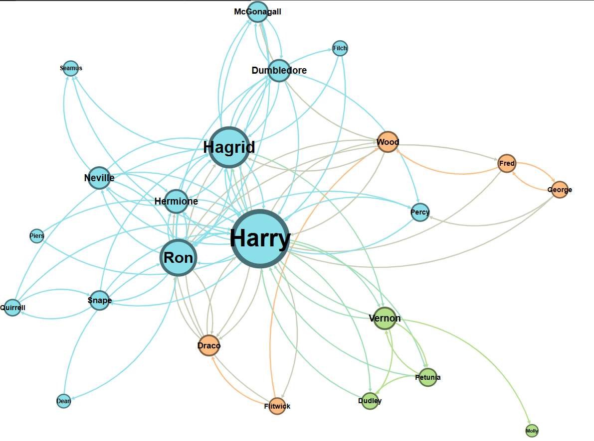
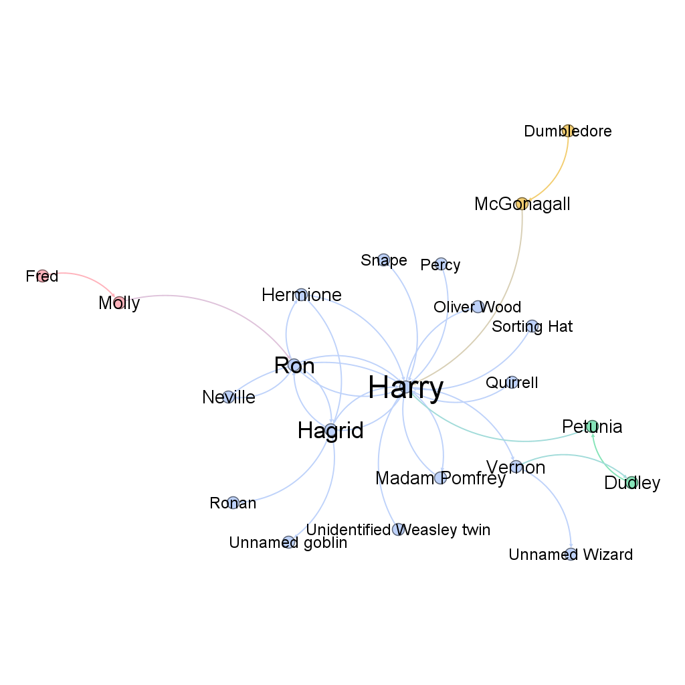

# Harry Potter Character Interaction Network

## About the Project

This project is based on the first Harry Potter book, *Harry Potter and the Philosopher's Stone*.

The main aim of this project is to study how different characters communicate with each other in the story.

I used Python to collect dialogues from the book and Gephi to create graphs showing the connections between characters.

I also manually checked a sample of dialogues to understand the mistakes that can happen when using automatic text analysis.

## How I Made This Project

1. **Dialogue Collection:** I used Python to extract dialogues from the book.
2. **Finding Characters:** I tried to identify who was speaking and who they were speaking to.
3. **Creating the Network:** I created CSV files containing characters and their possible connections.
4. **Manual Checking:** I checked 51 dialogue records from all 17 chapters to find mistakes in the automatically collected data.
5. **Making Graphs:** I used Gephi to create two character networks.
6. **Improving the Program:** I developed a batch-wise sampling program to select additional dialogue records without repeating earlier selections.

## Python Programs Used

### 1. harry_gephi_v2.py

This is the main Python program used for collecting dialogues and creating the original network.

It:
- Reads the book from a PDF file.
- Extracts possible dialogues.
- Tries to identify speakers and listeners.
- Creates CSV files for checking dialogues and building the network.

The program identified:

- **2,391 dialogue candidates**
- **1,214 attributed utterances**
- **24 characters**
- **87 different connections**

The speaker and listener information was identified automatically, so some connections may be incorrect.

### 2. validate_dialogues.py

This program was used to select dialogue records for manual checking.

It selects 3 dialogue records from each of the 17 chapters, giving a total of 51 records.

I checked these records in Excel and corrected the speaker and listener information where necessary.

The results of my manual checking are saved in `validation_review.xlsx`.

### 3. validate_dialogues_batches.py

I created this improved program to select additional dialogue samples without repeating previously selected records.

It:
- Selects 3 new dialogue records from each chapter.
- Excludes records already selected in earlier batches.
- Creates separate CSV files for new batches.
- Shows the number of records selected and how many remain in each chapter.

This makes it easier to continue the manual checking process in the future.

## Improved Dialogue Sampling

So far, I have selected 153 dialogues across three batches:

| Batch | Records | Status |
|---|---|---|
| Batch 1 | 51 | Manually checked |
| Batch 2 | 51 | Not yet checked |
| Batch 3 | 51 | Not yet checked |
| **Total** | **153** | **51 manually checked** |

Out of 2,391 dialogue candidates, 2,238 have not yet been selected for checking.

The second and third batches were generated using the improved Python program. They have not been manually verified and are not included in the manually checked network.

## What the Graphs Show

In the graphs:

- Each circle represents a character.
- Each line represents a possible conversation between two characters.
- Bigger circles represent characters with more connections.
- Different colors show groups of connected characters.

### Graph 1: Automatically Created Network

This graph was created using the data collected automatically by Python.

- **24 characters**
- **87 different connections**

It shows the larger character network, but some connections may be incorrect because the speaker and listener information was identified automatically.



### Graph 2: Manually Checked Network

This graph was created using the dialogue records I checked myself.

- **22 characters**
- **30 different connections**
- Based on **51 manually reviewed dialogue records**, including 42 direct interactions

This graph uses a smaller amount of data but includes manually checked speaker and listener information.



### Difference Between the Two Graphs

The first graph uses automatically collected information from a larger part of the book.

The second graph uses a smaller sample of manually checked dialogues.

The number of characters and connections is different because the graphs use different amounts of data.

Therefore, the graphs cannot be directly compared as if they cover the same dialogue records.

## Project Files

| File | Purpose |
|---|---|
| `harry_gephi_v2.py` | Extracts dialogues and creates the original network |
| `validate_dialogues.py` | Selects dialogue records for manual checking |
| `validate_dialogues_batches.py` | Selects additional batches without repeating earlier records |
| `dialogue_review.csv` | Contains the extracted dialogue candidates |
| `nodes.csv` | Contains characters in the original network |
| `edges.csv` | Contains connections in the original network |
| `validation_review.xlsx` | Contains 51 manually reviewed dialogue records |
| `validated_nodes.csv` | Contains characters in the manually checked network |
| `validated_edges.csv` | Contains connections in the manually checked network |
| `Harry_Potter_Network.png` | Image of the automatically created network |
| `Harry_Potter_Validated_Network.png` | Image of the manually checked network |
| `Harry_Potter_Dialogue_Network.gephi` | Gephi project file |

The additional batch CSV files contain new dialogue samples selected for future checking.

## How to Run the Programs

The project uses Python and the PyMuPDF library for extracting text from the PDF.

The main program requires a local copy of the book PDF.

To select additional dialogue records using the improved sampling program, open a terminal in the project folder and run:

```bash
python validate_dialogues_batches.py --input dialogue_review.csv --previous validation_review.xlsx
```

The program creates new batch CSV files inside the `validation_batches` folder.

It also displays chapter-wise progress in the terminal.

The original book PDF is not included in this repository.

## What I Learned

Through this project, I learned:

- How Python can be used to collect information from a literary text.
- How to organize data using CSV files.
- How to identify possible character interactions.
- How to create and understand character networks using Gephi.
- Why manually checking automatically collected data is important.
- How to improve a Python program to make repeated tasks easier.
- How graphs can help us study literature in a different way.

## Tools Used

- **Python:** To collect dialogues, identify possible interactions, and prepare data.
- **PyMuPDF:** To extract text from the PDF.
- **Excel:** To check and correct dialogue records.
- **Gephi:** To create and study character networks.
- **GitHub:** To store and share project files.

## Limitations

Python could not always correctly identify who was speaking or listening.

Some character connections were estimated using nearby dialogue records rather than confirmed conversations.

I manually checked only 51 dialogue records, not every dialogue in the book.

Although 153 records have been selected across three batches, only the first 51 have been manually reviewed.

The two graphs also use different amounts of data, so they cannot be compared as if they cover exactly the same conversations.

Therefore, the networks may not show every character interaction accurately.

## Conclusion

This project helped me understand how digital tools can be used to study literature.

Python helped me collect and organize dialogues, while Gephi helped me visualize possible relationships between characters.

Manual checking showed me that automatically collected data can contain mistakes.

By improving the dialogue sampling program, I also learned how to make the checking process more organized and easier to continue.

Overall, this project showed me that computers can help us study literature in new ways, but human checking is still important for accurate results.
